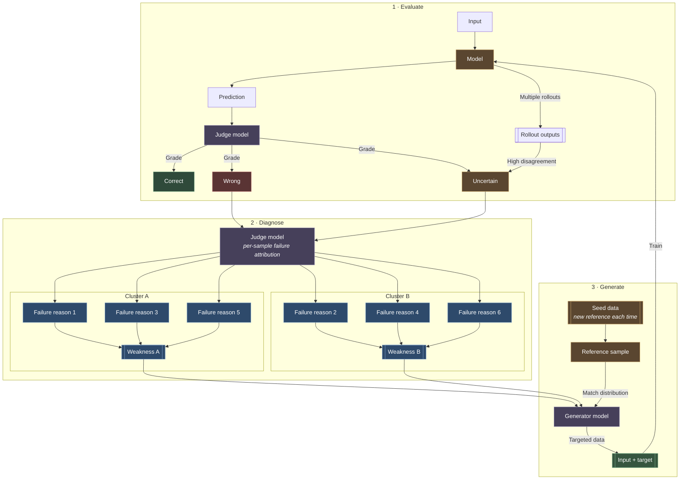

# RSI Loop

Build a recursive self-improving loop: Evaluate the target, Diagnose why it
fails, Generate data aimed at those weaknesses, train the target on it, and
repeat. Each round must be measured against a frozen held-out set so the loop
improves the target instead of overfitting to its own generated data.

## Loop Diagram

Keep this diagram as the canonical picture of the loop.

## Load References

- Load `references/stages.md` for detailed Evaluate, Diagnose, Generate, and
  Train procedures, judge rubrics, and prompt templates.
- Load `references/artifacts.md` before creating or resuming a loop workspace.

## Startup

1. Identify the target (`Model`): a fine-tunable model, a prompt, an agent, or
   a skill. "Train" means fine-tune for models and edit instructions or
   few-shot examples for prompts, agents, and skills.
2. Identify the task, the input source, the grading criteria, and the judge
   and generator models. Ask only if the task or success criteria cannot be
   inferred.
3. Create or resume `rsi/<slug>/`; read `state.md` and the latest
   `rounds/<n>/summary.md` if present.
4. Freeze a held-out eval set and a seed set before round 1. Never train on,
   generate from, or edit the held-out set.

## Round Flow

1. Evaluate: run the target on the eval inputs with `k` rollouts per input.
   The judge grades each prediction against the rubric as `correct`, `wrong`,
   or `uncertain`. Force `uncertain` when rollouts disagree above the
   threshold, even if the graded prediction looks correct.
2. Diagnose: send only `wrong` and `uncertain` samples to the judge for
   per-sample failure attribution (one concrete reason each). Cluster the
   reasons into named weaknesses with counts, examples, and a one-line
   hypothesis of the missing capability.
3. Generate: for each weakness, draw a fresh reference sample from the seed
   data (rotate references every call), and have the generator produce new
   `input + target` pairs that match the seed distribution while exercising
   that weakness. Filter outputs with the judge before use.
4. Train: update the target on the accepted targeted data, mixed with replay
   data from earlier rounds and correct seed samples to avoid regressions.
5. Gate: re-run Evaluate on the frozen held-out set. Keep the new target only
   if the primary metric improves and no guardrail metric regresses beyond
   tolerance; otherwise revert and adjust Diagnose or Generate.

## Guardrails

- Judge and generator must not see held-out targets during generation.
- Deduplicate generated data against the held-out set (exact and near-dup).
- Cap each weakness's share of a round's data so one cluster cannot dominate.
- Spot-check judge grades by hand or with a second judge each round; track
  judge agreement and stop if it drops.
- Log every round: metrics, weakness clusters, data counts, accept/reject.
- Stop when the metric plateaus for 2 rounds, the budget is spent, or the
  remaining failures are label noise or out of scope.

## Output

At handoff, report the per-round metric table, the weaknesses fixed and still
open, the accepted target version, and the path to `rsi/<slug>/`.
